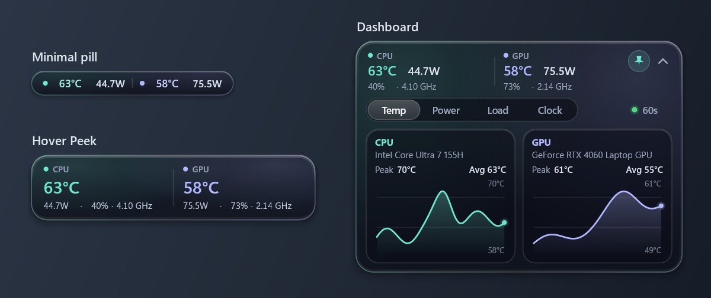
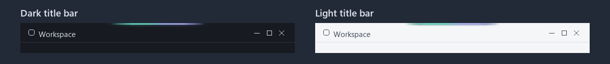

# Mmoni

Mmoni is a native Windows 11 overlay for live CPU and GPU temperature, power, load, and clock speed. Keep a small pill on screen, hover for more readings, or open the dashboard to inspect recent history. When the overlay gets in the way, it can retract into a temperature-colored micro-bar at the top edge.



*Native renders with sample telemetry.*

## Getting started

Mmoni targets **Windows 11 22H2 or later (x64)**. The native app builds as a single executable with a statically linked C++ runtime. The release executable requests administrator access when launched.

Install with `Mmoni-Setup-2.0.0-win-x64-native.exe` or [build and run the native executable](#build-from-source). After installing, launch **Mmoni** from the Start menu and look for its icon in the notification area. To start Mmoni at sign-in, select the option in the installer or enable **Start with Windows (Admin)** in the tray.

Package temperature and power readings on supported Intel and AMD CPUs require the PawnIO driver. Available readings depend on your hardware and installed drivers. [Download PawnIO](https://github.com/namazso/PawnIO.Setup/releases)

The native installer supports an in-place upgrade from v1 and retains `%LOCALAPPDATA%\Mmoni\settings.json`, which stores your preferences and overlay position.

## Using the overlay

| Action | Control |
| --- | --- |
| Set the pill's readings | Use **Minimal pill metrics** in the tray to choose temperature with power or load, or temperature alone. |
| See more live readings | Hover over the pill with **Hover Peek (Auto-expand)** enabled. |
| Inspect recent history | Click the pill or Peek to open the dashboard. Switch between **Temp**, **Power**, **Load**, and **Clock**, then hover over a chart to inspect an earlier reading. |
| Change the history window | Click the range button in the dashboard or use **History range** in the tray. Choose 60 seconds, 5 minutes, or 15 minutes. |
| Move or collapse the overlay | Drag the pill, Peek, or dashboard header to move it between monitors. Click the dashboard header or collapse button to return to the pill. |

The dashboard shows session peaks alongside averages for the selected history window. It opens pinned. Unpin it to let it collapse when the pointer leaves. Clear session peaks from the tray or by double-clicking a chart or its card.

Right-click the tray icon for **Show overlay**, **Visual style**, **GPU**, **Click-through**, **Auto-hide in fullscreen**, and **Reset position**. Visual styles include Liquid Glass, Fluent Acrylic, Chromatic Prism, and Precision Dark.

### Overlay behavior

Choose a mode under **Overlay behavior** in the tray.

| Mode | What happens when an app window overlaps the pill's position |
| --- | --- |
| **Smart Dodge** (default) | Retracts when the pointer approaches. The pill returns after the pointer moves away. |
| **Auto-Retract** | Retracts as soon as Mmoni detects an overlap. The pill returns when the overlap clears. |
| **Always visible** | Keeps the pill visible over other windows. The separate fullscreen auto-hide setting still applies. |

Near the top edge, a retracted pill becomes a thin, click-through **micro-bar**. Its left and right colors track CPU and GPU temperature. Away from the top edge, the pill dims and passes clicks to the app underneath.



To reveal the pill while it overlaps another window, hold **Alt** and move the pointer to the pill's position. At the top edge, you can also rest the pointer over the micro-bar briefly.

## Hardware telemetry

| Hardware | Sensor sources |
| --- | --- |
| **Intel and AMD CPUs** | [PawnIO modules](https://github.com/namazso/PawnIO.Modules/releases/tag/0.2.2) for supported package readings and Windows PDH counters for load and effective clock. |
| **NVIDIA GPUs** | NVML with an NVAPI fallback. |
| **AMD GPUs** | AMD ADLX. |
| **Intel GPUs** | Intel Graphics Control Library (IGCL), with a RAPL GT power fallback on supported integrated GPUs. |

Mmoni polls sensors once per second while the overlay is active. GPU polling checks the adapter's power state. A sleeping GPU can appear as **Idle** or **D3** in the overlay.

## Build from source

Use Visual Studio 2022 or 2026 with the **Desktop development with C++** workload and a Windows 11 SDK. The build script uses the MSVC, CMake, and Ninja tools from that installation. Run the commands below from the repository root.

```powershell
powershell -ExecutionPolicy Bypass -File native\scripts\build-native.ps1 -Configuration Release
```

Run `native\build\release\Mmoni.exe` to start the overlay. The packaging script below requires [Inno Setup 6](https://jrsoftware.org/inno-setup).

```powershell
powershell -ExecutionPolicy Bypass -File native\scripts\build-installer-native.ps1 -Configuration Release
```

The installer is written to `dist\Mmoni-Setup-2.0.0-win-x64-native.exe`.

### Diagnostics

```powershell
# Print three live sensor samples
.\native\build\release\Mmoni.exe --sensor-test --samples 3

# Measure native GUI startup, memory, and idle CPU usage
powershell -ExecutionPolicy Bypass -File native\scripts\benchmark-compare.ps1 -SteadySeconds 6
```

The benchmark requires a Release build and stops a running Mmoni instance before sampling.

## Project layout

| Path | Contents |
| --- | --- |
| [`native/src/ui`](native/src/ui) | Direct2D rendering, Windows composition, charts, and overlay behavior. |
| [`native/src/sensors`](native/src/sensors) | CPU and GPU providers, polling, and power-state checks. |
| [`native/src/app`](native/src/app) and [`native/src/platform`](native/src/platform) | Tray controls, settings, window placement, and startup integration. |
| [`native/scripts`](native/scripts) and [`native/installer`](native/installer) | Build, packaging, and benchmarking. |
| [`Mmoni.csproj`](Mmoni.csproj) | The legacy v1 WPF application for .NET 10. |
